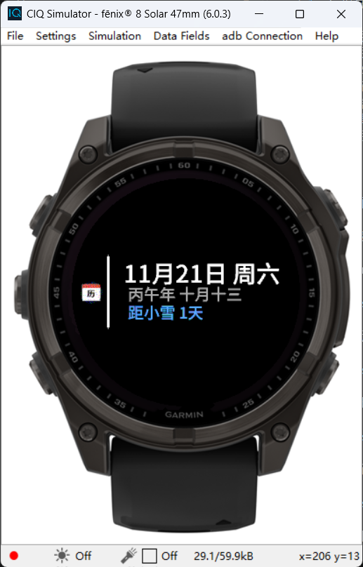
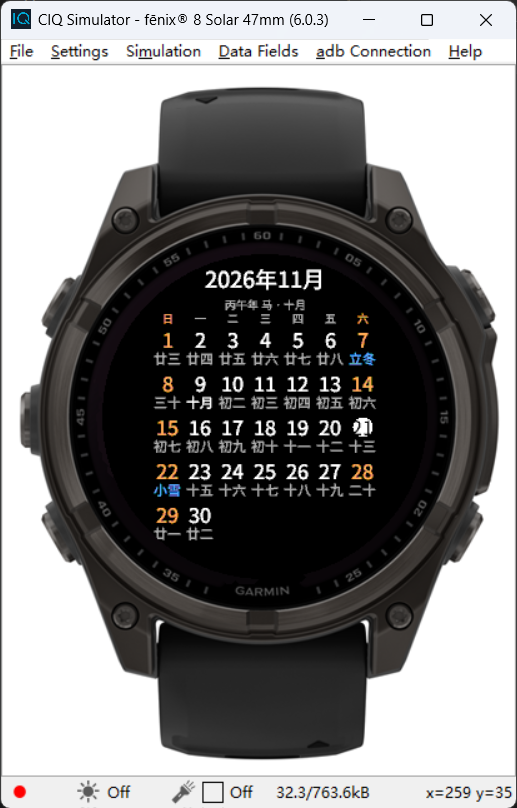
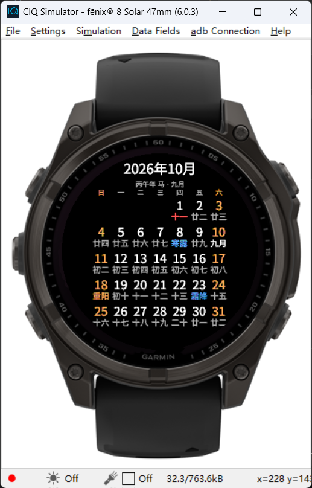
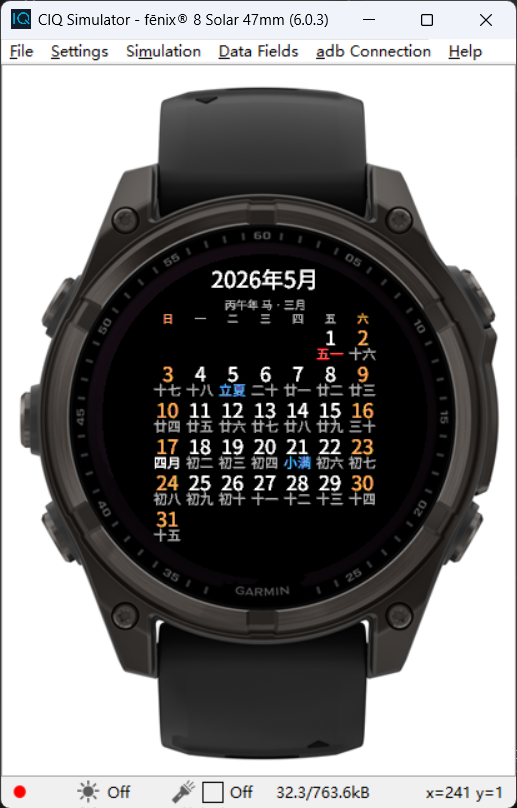
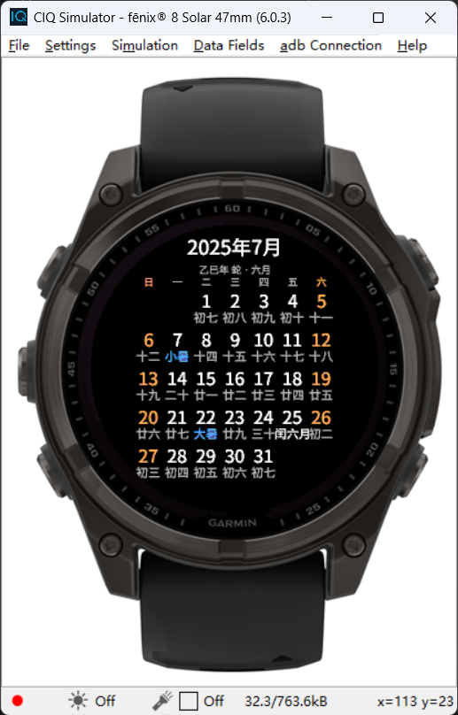

# 万年历 · Garmin fēnix 8

给 Garmin fēnix 8 写的中文万年历（Connect IQ 5.2.0）：主界面是当月「公历 + 农历」月历，翻腕 Glance 显示今日公历/农历和最近的节气或节日。

| 项目 | 值 |
| --- | --- |
| 应用类型 | watch-app（含 glance） |
| 应用 ID | `8c4e2a1d9f6b3c5d7e0a1b2c3d4e5f60` |
| minSdkVersion | 5.2.0 |
| 支持产品 | `fenix843mm` / `fenix847mm` / `fenix8pro47mm` / `fenix8solar47mm` / `fenix8solar51mm` |
| 语言 | 中文（zhs） |
| 权限 | 无 |
| 日期范围 | 1901-01 ~ 2100-12 |

---

## 界面预览

以下截图均来自 Connect IQ 模拟器（fēnix 8 47mm，454×454 视口）。

**Glance** —— 抬腕第一屏：今日公历（白）、农历干支与日期（灰）、最近事件与天数（按类型着色）。



**月历主界面** —— 2026 年 11 月：今日 21 号白圈高亮，22 号小雪为蓝色节气标注。



**节日与节气同屏** —— 2026 年 10 月：1 号国庆（法定红）、8 号寒露（节气蓝）、18 号重阳（传统橙）、23 号霜降。



**六行月份自动压缩行高** —— 2026 年 5 月：1 号五一（法定红）、5 号立夏、21 号小满，网格自动切换为 6 行仍完整不溢出。



**闰月** —— 2025 年 7 月：25 号显示三字标签「闰六月」，字号自动降档挤进单格。



---

## 功能

### 主界面（月历）

- 标题「2026年11月」；副标题是该月中的干支年、生肖与农历月名，例如「丙午年 马 · 十月」。
- 7 列 × 5 或 6 行网格：大号公历数字，下方小字是农历日名；初一显示月名（如「十月」），闰月显示「闰六月」。
- 节日/节气标注，每格只显示一个，优先级 **法定节假日 > 传统节日 > 节气**：
  - **法定**（红 `#FF6A4F`）：元旦、春节、劳动节、国庆节，另有清明（按节气「清明」当日判定）
  - **传统**（橙 `#FFB13B`）：元宵、龙头、端午、七夕、中元、中秋、重阳、腊八、小年、除夕
  - **节气**（蓝 `#64B5FF`）：二十四节气全部
- 周末（周日/周六）数字用暖红；今天用白色实心圆 + 黑色数字反显。
- 底部图例（法定 / 传统 / 节气 / 今日）与操作提示。
- 只标"日期"，不区分调休上班与休息日——放假安排每年底才由国务院公布，本 App 不参与推算。

### Glance（抬腕）

三行文本：

```
11月21日 周六           ← 白，24% 高度
丙午年 十月十三          ← 灰，55% 高度
距小雪 1天              ← 按事件着色，82% 高度
```

文案规则：当天为 `今日 小雪`，未来为 `距小雪 1天`，已过为 `已过白露 5天`。事件从今天起逐日向 ±45 天扫描取最近一个（节气或节日）。

---

## 操作

- **实体上/下键**：上键 = 上一月，下键 = 下一月（`CalendarDelegate.onKey` 处理 `KEY_UP` / `KEY_DOWN`）。
- **触屏滑动**：上滑 = 下一月，下滑 = 上一月（`onSwipe`）。
- **系统翻页回调**：`onPreviousPage` / `onNextPage` 作为兜底。fēnix 8 的上下按钮在系统中映射为翻页手势，因此三路都接上了。
- 到 1901-01 或 2100-12 边界后不再响应。

---

## 目录结构

```
manifest.xml              产品、权限、语言声明
monkey.jungle             源码与资源路径
source/
  WanNianLiApp.mc         App 入口：getInitialView（月历 + 输入代理）、getGlanceView
  CalendarView.mc         月历界面：布局、配色、翻月、按键/滑动处理
  GlanceView.mc           Glance 三行文本
  LunarCal.mc             历法算法：日序换算、农历换算、干支、节气、节日、最近事件
  Data.mc                 生成的数据表（农历 200 年 + 年起始偏移 + 200 年节气日）
resources/
  strings.xml             AppName = 万年历
  bitmaps.xml、images/launcher_icon.png
tools/
  gen_data.py             重新生成 Data.mc（农历 .NET 校验 + 节气天文算法 + 天文台比对）
  build.ps1               编译（可 -Device 指定机型、-NoDeploy 只编译）
  shot.ps1 / click.ps1 / drag.ps1 / sendkeys.ps1   模拟器截图与交互
screenshots/              模拟器实拍图
LunarCalendar.prg         全机型通用安装包
```

---

## 编译与部署

环境按 Windows + VSCode 的 Monkey C 插件配置好即可。下面的路径按本机实际情况替换（SDK 目录、`developer_key`、JDK 路径）。

`monkeyc` 依赖 `java`，若 `java` 不在 PATH，先补上：

```powershell
$env:PATH = "C:\Program Files\Java\jdk-27.0.1.1\bin;" + $env:PATH
$bin = "$env:APPDATA\Garmin\ConnectIQ\Sdks\connectiq-sdk-win-9.3.0-2026-10-20-95888f262\bin"

# 单机型编译（调试用，产物只含该机型）
& "$bin\monkeyc.bat" -f monkey.jungle -o LunarCalendar.prg -d fenix847mm -y C:\Users\VMware\developer_key --warn

# 全机型编译（不带 -d，产物可装到 manifest 里任一机型）
& "$bin\monkeyc.bat" -f monkey.jungle -o LunarCalendar.prg -y C:\Users\VMware\developer_key --warn
```

部署到模拟器（`monkeydo` 会常驻占用控制台，结束按 Ctrl+C；重新部署前先 `Stop-Process -Name java -Force`）：

```powershell
& "$bin\monkeydo.bat" LunarCalendar.prg fenix847mm
```

启动模拟器：

```powershell
Start-Process "$bin\simulator.exe" -ArgumentList "-d","fenix847mm"
```

或直接用封装脚本：

```powershell
pwsh -File tools\build.ps1                 # 编译 + 部署到 fenix847mm
pwsh -File tools\build.ps1 -NoDeploy       # 只编译
pwsh -File tools\build.ps1 -Device fenix8solar51mm
```

> 编译时会提示 `The entry point '$.WanNianLiApp' was implicitly added to the glance process` —— 这是 `(:glance)` 视图的正常行为，不是错误。

---

## 装进真表

1. **开发者侧载（推荐，自用）**：USB 连接手表，把编译出的 `LunarCalendar.prg` 复制到手表 `GARMIN\APPS\` 目录，断开后在应用列表里就会出现「万年历」。必须用**与签名一致的同一把 `developer_key`** 编译，否则手表会拒绝加载。
2. **Connect IQ Store 侧载**：`monkeyc` 加 `-e` 导出 `.iq` 包，登录 Connect IQ 开发者后台创建应用并上传，再通过商店或 Garmin Express 推送到手表。
3. **开启 Glance**：装好后进手表「设置 → 外观 / Glance」列表，把「万年历」这一项打开，抬腕即可看到今日信息。

---

## 算法与数据来源

- **公历 ↔ 日序**：以 1901-02-19（农历 1900 年最后一天之后）为纪元日 `EPOCH_DAY = -25153`，全部换算都是整数加减，不依赖任何库。
- **农历**：`Data.mc` 存 1900-2100 每年一个压缩整数（闰月月份 + 12/13 个月的大小月位图），再存每年正月初一的日序偏移 `LUNAR_YEAR_START`。换算时对年份二分查找，再在年内按位运算累加各月天数，单次换算约 20 次运算。
  > 最初实现是"从 1901 年逐年累减"，42 格 × 2 次换算上万次指令，在模拟器上会触发 watchdog（`Code Executed Too Late / Too Long`）直接崩溃；改成查表 + 二分后才稳定。月历每格也只算一次农历，复用于节日判定。
- **节气**：按太阳视黄经每 15° 预计算 200 年 × 24 个「月内第几天」。2026 年全表与香港天文台《二十四节气》逐条比对，日期全部一致、时刻误差在 0.7 分钟内。
- **干支 / 生肖**：按农历年（正月初一换年）计算，60 甲子循环。
- **节日**：公历固定（元旦 1/1、劳动节 5/1、国庆 10/1）+ 农历固定（除夕、春节、元宵、龙头、端午、七夕、中元、中秋、重阳、腊八、小年）+ 清明（取节气当日）。**闰月不过节**：闰月里的同名日期不算节日。
- **最近事件**：`nearestEvent` 从今天起向 ±45 天逐日扫描，取最近的一个节气/节日，返回 `[全名, 简称, 类型, 差值]`。
- **数据重建**：`python tools\gen_data.py` 会重新生成 `Data.mc`，并打印农历月首校验（应为 `mismatches: 0`）与 2026 节气比对结果。

---

## 已知限制

- **中文字体**：系统内置 CJK 字体最小档也有 37px 高（`FONT_XTINY` 画「廿一」实测 62×37），塞不进 7 列格子。因此改用 CIQ 矢量字体 `Graphics.getVectorFont({:face => "NotoSansSCMedium", :size => N})`：可任意缩放、跟随 `setColor` 着色。格子内农历/节日字用 17px，三字标签自动降到 13px。15px 时「寒露 / 霜降 / 重阳」这类多笔画字会糊，17px 才可辨认。
- 若设备不支持矢量字体（`Graphics has :VectorFont` 为 false），代码会回退到系统 `FONT_XTINY`，此时中文偏大、可能溢出。fēnix 8 全系支持矢量字体，不受影响。
- 自定义 BMFont（`resources/fonts/*.fnt`）方案试过，编译期报 `Invalid '$.Toybox.Lang.ResourceId' passed as parameter 3`，已废弃并从工程移除。
- **模拟器无法验证实体按键**：模拟器把 up/down 按钮当翻页手势，方向键也不产生 key 事件，因此只能在模拟器里用滑动验证切月，`onKey` 路径在真机上生效。
- 不显示调休，只标节日日期本身。

---

## 数据校验基准

| 公历 | 农历 | 说明 |
| --- | --- | --- |
| 2026-11-21 | 2026 年十月十三 | 今天；小雪 11/22 |
| 2025-10-06 | 2025 年八月十五 | 中秋 |
| 2025-07-25 | 2025 年闰六月初一 | 闰月标签 |
| 2024-02-10 | 2024 年正月初一 | 春节 |

2026 年节气抽查：立夏 5/5、小满 5/21、小暑 7/7、大暑 7/23、寒露 10/8、霜降 10/23、小雪 11/22、大雪 12/7、冬至 12/22，与香港天文台一致。
